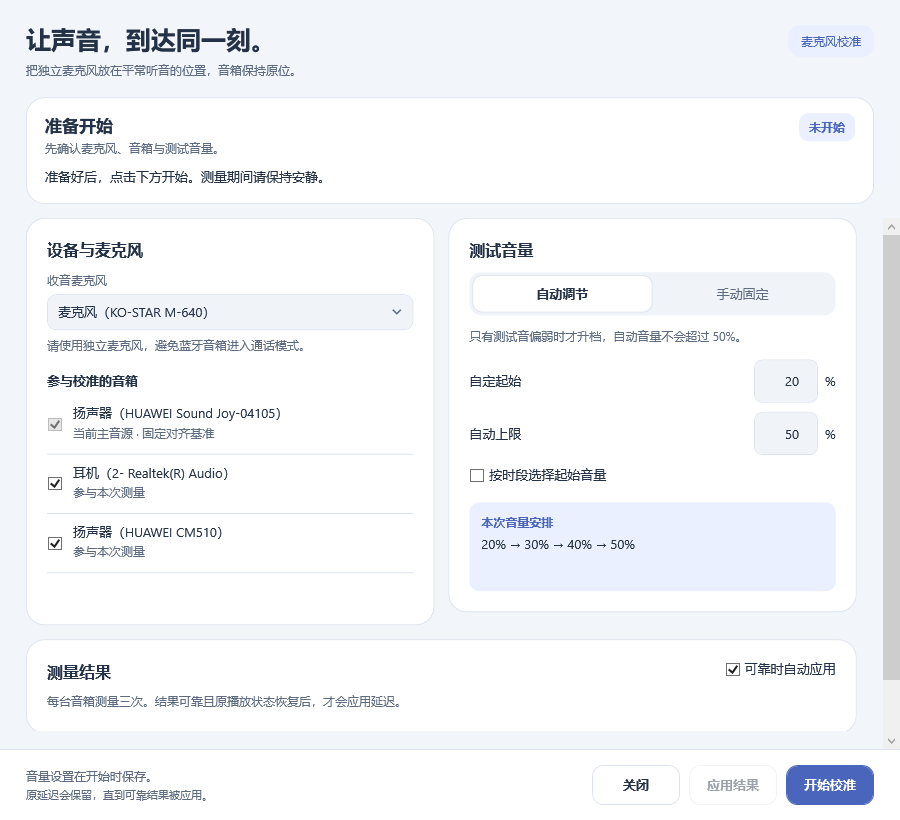
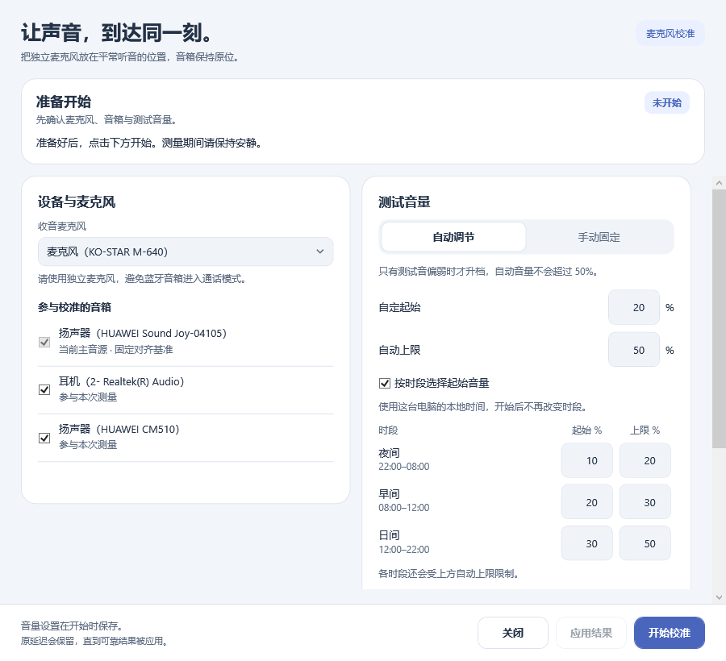
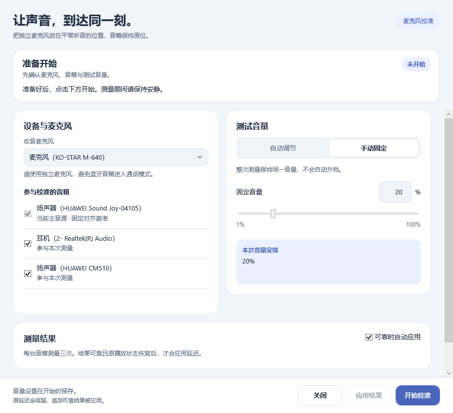
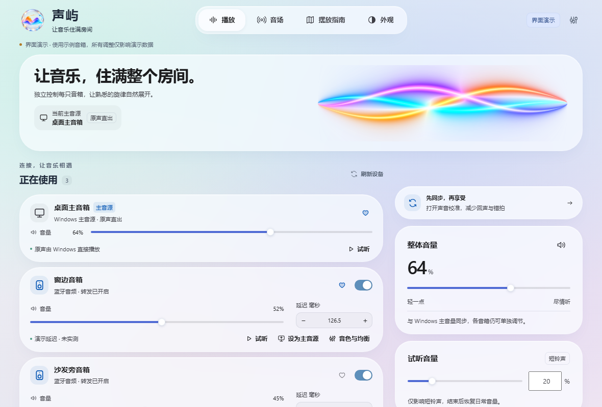

# 校准界面与设备恢复改进（preview.4）

## 使用方式

- 主页面的“试听音量”可设置 1–100%，用于每台音箱的试听按钮。试听暂时使用该音量，结束恢复原值，不改变日常播放音量。
- 麦克风校准分为“自动调节”和“手动固定”。默认自动从 20% 开始，仅测试音过弱时按 10 个百分点逐档提高，默认上限 50%。手动使用固定音量，不自动升档。
- 可开启按时段调整。默认夜间 22:00–08:00 使用 10%–20%，早间 08:00–12:00 使用 20%–30%，日间 12:00–22:00 使用 30%–50%。每段起始与上限可修改，仍受自动总上限限制。按电脑本地时间，在点击开始时确定本次档位，中途不切换。
- 设置在开始校准前保存。主页面试听音量独立保存，不覆盖校准设置。
- 页面把设备、音量、当前步骤、测量结果和技术详情分开。开始后收起设置；详细错误可通过“复制诊断”主动复制，不自动读取或改变剪贴板。
- 如果恢复原音量失败，会暂停相关声音恢复并提示检查，避免临时较高音量下突然恢复音乐。

## 关于“麦克风录音中断”

原提示也可能表示识别到测试音后，声音的时间记录不连续，并不等同于麦克风断开。新提示区分时间记录异常和实际收音停止，增加纯数字诊断，仍不保存录音。

已修正无法定位的时间记录被错误映射到录音开头的边界问题。没有降低校准可靠性要求，也没有凭推测增大缓冲。用户反复失败的具体原因仍需下一次手动校准后的完整诊断才能确认。

## 验证范围

本轮不自动播放、录音或控制桌面。后台界面截图使用示例设备名称，不代表实体音箱已经验收。编译与静态审查的结果另行记录；未运行自动化测试。

## 设备被拔掉时

刷新会先读取新的设备信息，再更新列表；原主音源断开时保留输出选择，提示等待恢复。重新连接后可刷新重试，也可在另一台已连接设备上选择“设为主音源”。刷新不会擅自把另一台音箱选为主音源。

托盘菜单已修正首次右键被取消显示的问题。面向用户的音源错误提示改为“声屿”，原作与第三方署名继续保留。

## 界面预览

以下为实际界面文件的后台渲染，使用示例设备数据，没有打开桌面窗口或音频设备：

## 连接分组与备注

主页面区分“正在使用”“已连接但未启用”“未连接”。连接状态以 Windows 音频端点为依据，与是否开启转发分开；未连接设备默认折叠。备注按设备ID分别保存，保留完整的原设备名称，方便区分同名音箱。

## 蓝牙连接错误

`0x8889000F` 表示 Windows 无法建立该设备的音频端点，不表示仅支持一台蓝牙音箱。新版保留错误码与失败步骤，不再把所有播放初始化失败都称为“超出范围”。连接恢复与实际声音仍需使用者确认。

## 日常音量与测试音量

整体音量用于日常播放，主页面直接请求后台设置 Windows 音量，再以实际读取结果更新显示，不依赖隐藏的旧页面滑杆。

试听和校准音量为临时设置，恢复基线来自本次开始前的实际读取。重要步骤会核对目标值与实际值；发现变化时停止，诊断保留该步骤，不会反复强写音量或仅提高音量继续测量。

用户报告 Joy 在测试期间从目标音量回到最初的14%。目前不能确认是驱动、设备回报还是其他原因；必须与已确认的新页面间接执行缺陷分别说明。新增检查有助于定位，不能替代实体设备验收。
